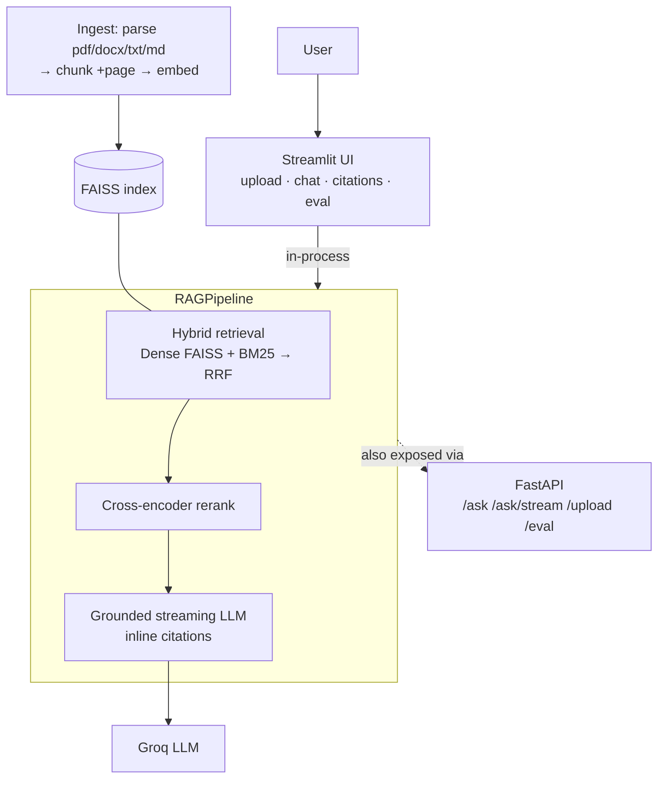

# DocMind — RAG Document Assistant


> **🔗 Live demo:** _<!-- paste your Streamlit Cloud URL here, e.g. https://docmind.streamlit.app -->_ **← add the live link after deploying**

Upload your PDFs, DOCX, TXT, or Markdown, ask questions, and get **streaming,
grounded answers with clickable source citations** — plus a live **evaluation
dashboard** that scores retrieval and answer quality. Built as a production-shaped
RAG system: **hybrid dense + BM25 retrieval**, **cross-encoder reranking**, and a
real metrics harness. Ships as one **Streamlit** app (running the pipeline
in-process) with a **FastAPI** service preserved in the repo, and deploys **free**
on Streamlit Community Cloud.

## Metrics (real, on the bundled eval set)

Measured by the built-in harness over 12 labelled questions — reproduce with
`python -m eval.evaluate` or the **Evaluation** tab in the app.

| Metric | Score | What it measures |
|---|---|---|
| **recall@5** | **1.00** | Correct source document is in the top-5 retrieved chunks (retriever quality) |
| **MRR** | **0.96** | How near the top the first correct passage lands after reranking (ordering) |
| **faithfulness** | **0.78** | Fraction of answer claims supported by context, via LLM-as-judge (anti-hallucination) |
| **answer relevance** | **0.82** | Answer is semantically on-topic for the question |

## Features

- 📤 **Multi-format upload** — PDF, DOCX, TXT, Markdown, chunked with overlap and
  indexed live.
- 🔍 **Hybrid retrieval** — dense FAISS (meaning) **+** BM25 (exact keywords),
  fused with Reciprocal Rank Fusion so neither score scale dominates.
- 🎯 **Cross-encoder reranking** — a shortlist re-scored by a model that reads
  query and passage together; its scores show next to each citation.
- 💬 **Grounded, cited, streaming answers** — answers only from retrieved context,
  cites passages inline as `[n]`, admits when it doesn't know, streams token-by-token.
- 🔗 **Clickable citations** — every answer's sources appear in a panel; click one
  to read the exact retrieved passage (with PDF page number).
- 📊 **Evaluation dashboard** — recall@k, MRR, faithfulness, answer relevance as
  metric cards + a chart, each explained in one line, re-runnable in the UI.
- 🧰 **Production touches** — Pydantic validation, structured logging, rate
  limiting (on the API), a typed & lazy-loaded pipeline, pytest, Docker, and CI.

## Technology stack

| Layer | Choice |
|---|---|
| Frontend | Streamlit |
| Backend (in repo) | FastAPI (REST + SSE streaming) |
| LLM | Groq (`llama-3.1-8b-instant`) — any OpenAI-compatible endpoint |
| Embeddings | `sentence-transformers/all-MiniLM-L6-v2` |
| Vector DB | FAISS (inner-product = cosine) |
| Retrieval | BM25 (`rank-bm25`) + FAISS, fused with RRF |
| Reranking | Cross-encoder `ms-marco-MiniLM-L-6-v2` |
| Evaluation | recall@k · MRR · faithfulness · answer relevance |
| Deployment | GitHub + Streamlit Community Cloud (free) |
| Container | Docker |
| Testing | pytest |

Both models are deliberately small (MiniLM-class, ~90 MB each) — a strong
quality-for-RAM tradeoff that fits Streamlit Community Cloud's memory limit.

## Architecture

The deployed Streamlit app calls the RAG pipeline **in-process** (one service, no
network hop). The same pipeline also powers a **FastAPI** service (kept in the
repo for API use and local dev).



Full write-up — the two-stage retrieval design, the SSE streaming contract, and
the evaluation rationale — in [`docs/ARCHITECTURE.md`](docs/ARCHITECTURE.md).

## How RAG works here

1. **Ingest** — documents are parsed into `(page, text)` segments (so PDF page
   numbers survive), split into overlapping chunks, embedded, and stored in FAISS.
2. **Retrieve** — the question is run through **two** retrievers in parallel:
   dense (embedding/FAISS) and sparse (BM25), whose ranked lists are fused by RRF.
3. **Rerank** — a cross-encoder re-scores the shortlist by reading each
   `(query, passage)` pair together — far more accurate than the first-stage scores.
4. **Generate** — the top passages are numbered into the prompt; the LLM answers
   **only** from them, cites `[n]`, and streams the answer token-by-token.

### Retrieval pipeline

```
query ─┬─▶ Dense (MiniLM → FAISS cosine) ─┐
       └─▶ Sparse (BM25 lexical) ─────────┴─▶ RRF fusion ─▶ Cross-encoder rerank ─▶ top-N passages ─▶ LLM
```

RRF fuses on **rank position**, not raw scores, so FAISS's cosine scale and BM25's
unbounded scale can't dominate each other: `fused(d) = Σ 1/(rrf_k + rank_r(d))`.
Set `HYBRID=false` for a dense-only ablation.

## Evaluation metrics

Each metric isolates a different failure mode, so you know *where* a wrong answer
came from:

| Metric | Stage | Question it answers |
|---|---|---|
| **recall@k** | retriever | Did the gold document reach the top-k candidates at all? |
| **MRR** | reranker | How near the top is the first correct passage after reranking? |
| **faithfulness** | generation | Are the answer's claims supported by the context (not hallucinated)? |
| **answer relevance** | generation | Is the answer actually on-topic for the question? |

Faithfulness uses LLM-as-judge when a key is configured, else an embedding-overlap
fallback.

## Screenshots

_Add three screenshots from the running app to `docs/screenshots/`, then they'll
render here:_

<!--


-->

## Installation (local)

```bash
# 1. Install
pip install -r requirements.txt

# 2. Configure an LLM key (Groq's free tier works great)
cp .env.example .env        # then edit LLM_API_KEY  (see .env.example for Groq)

# 3. Run the app — it builds the sample index on first run
streamlit run ui/streamlit_app.py
#    open http://localhost:8501
```

Without an LLM key the app still runs retrieval + reranking (answers show the top
retrieved passage), so you can demo the retrieval half offline.

<details>
<summary>Optional: run the FastAPI service too</summary>

```bash
uvicorn api.main:app --port 8000     # interactive docs at /docs
python -m src.ingest --docs data/sample_docs   # (re)build the index from a folder
python -m eval.evaluate              # run the eval harness in the terminal
```
</details>

### Run in Docker

```bash
docker build -t docmind .
docker run -p 8501:8501 -e LLM_API_KEY=... -e LLM_BASE_URL=https://api.groq.com/openai/v1 -e LLM_MODEL=llama-3.1-8b-instant docmind
#    open http://localhost:8501
```

## Deployment (free — Streamlit Community Cloud)

1. Push this repo to **GitHub** (public).
2. Go to <https://share.streamlit.io> → **New app**, pick your repo/branch, set the
   main file to **`ui/streamlit_app.py`**.
3. In **Advanced settings → Secrets**, paste your keys (TOML):
   ```toml
   LLM_API_KEY = "your-groq-key"
   LLM_BASE_URL = "https://api.groq.com/openai/v1"
   LLM_MODEL = "llama-3.1-8b-instant"
   ```
4. Deploy. You get a public `*.streamlit.app` URL — put it at the top of this README.

Full step-by-step (GitHub + Streamlit Cloud) in [`docs/DEPLOY.md`](docs/DEPLOY.md).
API endpoint reference in [`docs/API.md`](docs/API.md).

## Tests

```bash
pytest
```

Covers chunking + page-metadata propagation, BM25 lexical matching, RRF fusion
math, hybrid-retrieval recall, and citation correctness. CI
(`.github/workflows/ci.yml`) runs ruff + pytest on every push.

## Project structure

```
config.py            all tunable settings (env-overridable)
src/
  chunking.py        recursive + semantic chunking (page-aware)
  embeddings.py      sentence-transformers bi-encoder
  vectorstore.py     FAISS index (build/save/load/search)
  retrieval.py       dense + BM25 + RRF hybrid (composable Retriever interface)
  reranker.py        cross-encoder reranking
  llm.py             grounded generation + streaming, with citations
  pipeline.py        retrieve → rerank → generate; lazy models; live upload indexing
  ingest.py          parse (pdf/docx/txt/md) → chunk → embed → FAISS
api/
  main.py            FastAPI: /health /ask /ask/stream /upload /eval
  schemas.py         Pydantic request/response models
ui/streamlit_app.py  the deployed app — upload · streaming chat · citations · eval
eval/                recall@k · MRR · faithfulness · answer relevance
tests/               pytest: chunking, retrieval, citations
docs/                ARCHITECTURE.md · DEPLOY.md · API.md
Dockerfile · run.sh  containerized Streamlit app
```

## Configuration

All settings live in `config.py`, overridable via environment / Streamlit secrets:

| Variable | Default | Meaning |
|---|---|---|
| `EMBED_MODEL` | `all-MiniLM-L6-v2` | bi-encoder embedding model |
| `RERANKER_MODEL` | `ms-marco-MiniLM-L-6-v2` | cross-encoder reranker |
| `HYBRID` | `true` | fuse dense + BM25 (set `false` for dense-only) |
| `RRF_K` | `60` | reciprocal-rank-fusion constant |
| `RETRIEVE_K` | `20` | candidates per retriever before reranking |
| `RERANK_TOP_N` | `5` | passages kept after reranking |
| `CHUNK_STRATEGY` | `recursive` | `recursive` or `semantic` |
| `LLM_MODEL` | `gpt-4o-mini` | any OpenAI-compatible model |

## Future improvements

- Agentic retrieval / query decomposition for multi-hop questions.
- Persistent uploads (mounted volume or a hosted vector store) so user docs
  survive restarts.
- Conversational follow-ups with memory.
- Multimodal parsing of tables/images in PDFs.
- Multi-user auth + saved chat history.

## Resume bullet points

- Built and deployed a production-style RAG document assistant (FastAPI, FAISS,
  hybrid **dense + BM25** retrieval with RRF fusion, **cross-encoder reranking**)
  serving **grounded, cited, streaming** answers — deployed free on Streamlit
  Community Cloud. _[live link]_
- Implemented a RAG **evaluation pipeline** (recall@k, MRR, faithfulness, answer
  relevance) surfaced in a live dashboard — **recall@5 1.00, MRR 0.96,
  faithfulness 0.78**.
- Engineered memory-efficient serving (lazy model loading, single cached pipeline,
  MiniLM-class models) to run within a 1 GB free-tier RAM budget.

## License

MIT — see [LICENSE](LICENSE).
